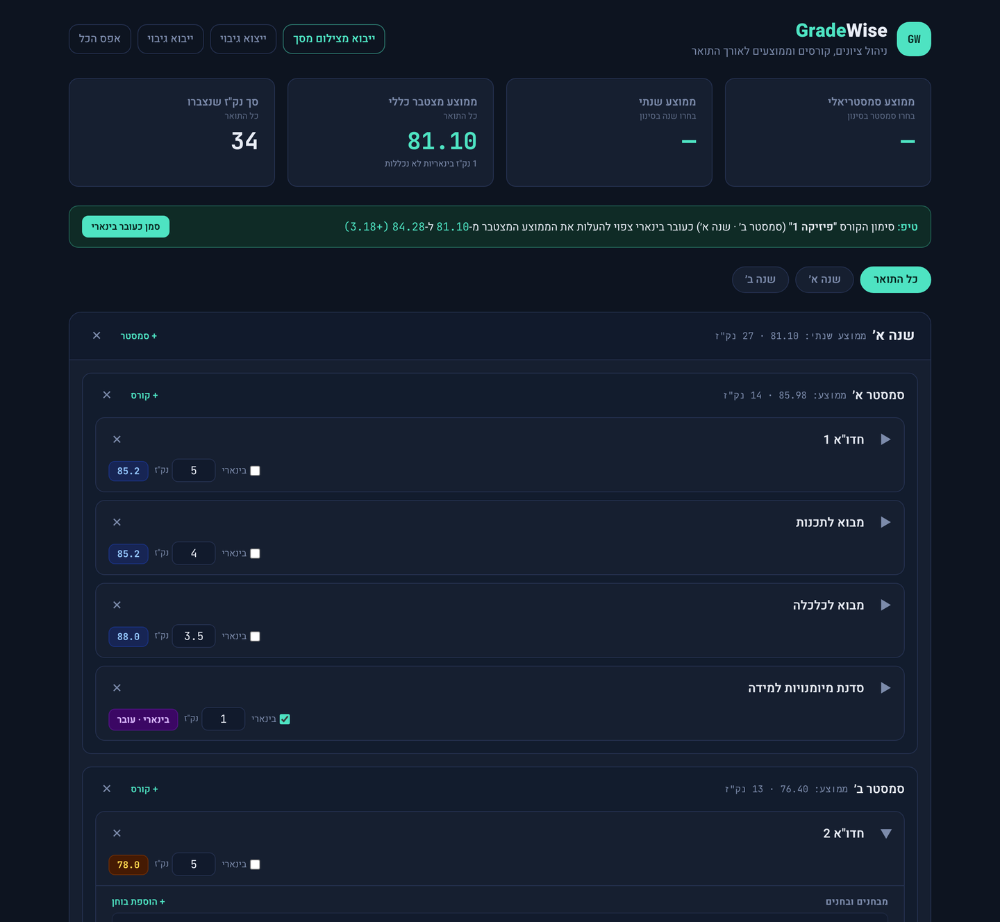
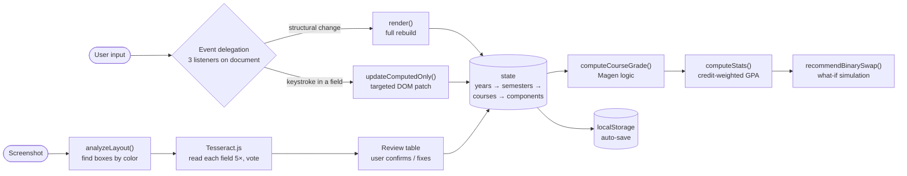

<h1 align="center">GradeWise</h1>

<p align="center">
  <b>A GPA calculator built for how Israeli universities actually grade:</b><br/>
  credit-weighted averages, protective ("Magen") exams, pass/fail courses —<br/>
  and grades imported straight from a screenshot, with OCR that runs on your phone.
</p>

<p align="center">
  <a href="https://guyavron.github.io/gradewise/"><b>🔗 Live demo</b></a> ·
  
  
  
  
  
</p>

<p align="center">
  
  <br/><sub>Demo data (fictional). Try it: open the live demo and click <b>"טען נתוני דמו"</b>.</sub>
</p>

---

## The problem

Friends in later years of their degree kept asking the same question: **which course should I mark as pass/fail ("עובר בינארי") to raise my average the most?** An 80 in a 3-credit course, or an 85 in a 4.5-credit one? The answer depends on the whole transcript, and nobody was doing the math.

Generic GPA calculators didn't help. They assume the US 0–4 scale and break on two Israeli rules:

1. **Magen (protective) exams.** A quiz or assignment marked "Magen" only counts if its grade is **higher** than the final exam. Otherwise it is dropped and its weight is redistributed proportionally across the rest of the course.
2. **Pass/fail (binary) courses.** Their credits count toward the degree, but they must **not** affect the average.

So I built a tool for my own Ben-Gurion University transcript that I could also send to friends as a plain link.

## What it does

- **Pass/fail recommendation engine**: simulates *"what if I marked this course pass/fail?"* for every course and suggests the single swap that raises the cumulative GPA the most, with one-click apply
- **Import grades from a screenshot**: upload screenshots of the BGU app's grades screen; course names, grades and credits are read **on the device** (no upload) and shown in a review table before anything is saved
- **Year → Semester → Course → Component** hierarchy, with semester, annual and cumulative GPA
- **Full Magen logic**: automatic drop-and-redistribute when a protective grade doesn't beat the final exam
- **Binary courses** excluded from the average but still counted in total credits
- **Weight validation**: component weights must sum to 100%, with inline warnings instead of silent errors
- **One-click demo data** so a first-time visitor sees every feature without typing a grade
- **Auto-save** in the browser (no sign-up), **JSON export/import** as a backup, and a warning when the link is opened inside an in-app browser (Instagram, WhatsApp…) that may not keep data
- Fully **Hebrew / RTL**, mobile-first, dark "academic terminal" design

## Architecture

The whole app is **one static HTML file** (~1,650 lines, no build step), deployed on GitHub Pages. The OCR engine is loaded **only when the import button is first used**.



## Key engineering decisions

| Decision | Why |
|---|---|
| **No framework, single file** | The UI is bounded and the goal was a link anyone can open. One static file deploys anywhere, with no build pipeline to maintain. |
| **Two render paths** instead of one | A full re-render on every keystroke destroyed the input being typed in (see Challenges). Structural changes rebuild; live typing only patches computed values. |
| **`localStorage` instead of accounts** | Accounts need a backend, which GitHub Pages can't host. Per-browser storage gives every friend private data on the same public URL, with no login. |
| **OCR in the browser (Tesseract.js) instead of an AI model on a server** | Free, no backend, and grades never leave the phone. A server-side vision model would be more accurate, but needs an API key behind a public endpoint (abuse, cost) and means sending people's grades to a third party. |
| **Find the layout by color first, then OCR each field** | Running OCR on the whole screenshot produced silent errors in credits (`770.00` instead of `0.00`). Locating the blue grade box and orange credits box by pixel color, then reading each one separately with a digits-only whitelist, is far more reliable. |
| **Flag instead of guess** | Every number is read 5 times with different preprocessing and accepted only if at least two reads agree. Otherwise the field is highlighted for the user. A wrong grade that looks right is worse than an empty one. |
| **Lazy-load the OCR engine** | Tesseract plus the Hebrew and English models is ~7 MB. Loading it only on first use keeps the app instant for everyone who never imports. |

## Challenges & how I solved them

**1. "88" became "38", but only on a real iPhone**
- *Symptom:* the import passed every local test (19/19 courses), but on my phone one grade came back as 38 instead of 88, with no warning.
- *Diagnosis:* the test screenshots had been downscaled on the way to me, and browsers resize canvas images differently (Safari's smoothing ≠ Chrome's). So the phone fed slightly different pixels to the OCR, and a thin "8" read as "3". The Hebrew language model was also hurting digit recognition.
- *Fix:* read text from the **original-resolution** image, do the resizing with my own bilinear interpolation in JavaScript (identical pixels in every browser), use a separate **English-only** OCR worker for digits, and add **voting** across 5 threshold variants. Re-tested on 24 runs (4 real screenshots × widths 750–1290 px + JPEG compression, ~300 numbers): **0 wrong values**.

**2. The input that kept losing focus**
- *Symptom:* while typing a grade, the cursor sometimes jumped out of the field and the next keystroke disappeared.
- *Diagnosis:* every keystroke triggered a full DOM rebuild, so the input element being typed in was destroyed and recreated.
- *Fix:* split rendering into `render()` (structural) and `updateComputedOnly()` (patches only computed values). The same rule now applies to the OCR review table.

**3. Data disappearing on phones**
- *Symptom:* friends had to re-enter all their courses on every visit.
- *Diagnosis:* a normal refresh kept the data, which ruled out a save bug. Mobile browsers (and especially in-app browsers opened from a chat link) evict or wipe site storage.
- *Fix:* layered defense: saves on `visibilitychange` / `pagehide`, a `navigator.storage.persist()` request, a manual JSON backup, an in-app-browser warning, and screenshot import, so re-entering a semester takes seconds instead of minutes.

## Results

- In daily use for my own degree. The cumulative average it computes **matches the official BGU figure**.
- Shared with friends as a plain link (no sign-up), passed along between students.
- Helped friends during reserve duty pick their pass/fail course without doing the math by hand.
- Several features (the recommendation engine, screenshot import, the in-app browser warning) came from **using the app myself** and from friends' feedback, not from the original plan.

## How I built it

I built GradeWise with an **AI-assisted workflow, using Claude as the implementation partner**. My part:

- **Defined the domain rules** (the averaging formula, the Magen comparison, weight validation) and approved a written plan before any code
- **Made the product decisions**: on-device OCR over a paid AI API, flag-instead-of-guess, which courses to skip on import, the design direction
- **Tested on real devices with real data**: the iPhone test is what exposed the 88→38 bug that local tests missed
- **Kept a living `CLAUDE.md`**: a line-numbered map of every function, updated after each structural change, so later edits go straight to the right code

## Limitations & next steps

- Screenshot import is tuned to the **BGU app's grades screen**; other universities' layouts aren't supported yet.
- Data lives per browser, per device. There's no cross-device sync (by design, to avoid accounts).
- The recommendation suggests one pass/fail course at a time, not a multi-course optimization.
- Next: import support for other universities' grade screens, and an automated test suite for the OCR pipeline with fictional screenshots.

## Run locally

No install, no build:

```bash
git clone https://github.com/guyavron/gradewise.git
cd gradewise
# open index.html in any browser
```

---

<p align="center"><i>Built by <a href="https://github.com/guyavron">Guy Avron</a> · Industrial Engineering & Management, Ben-Gurion University</i></p>
